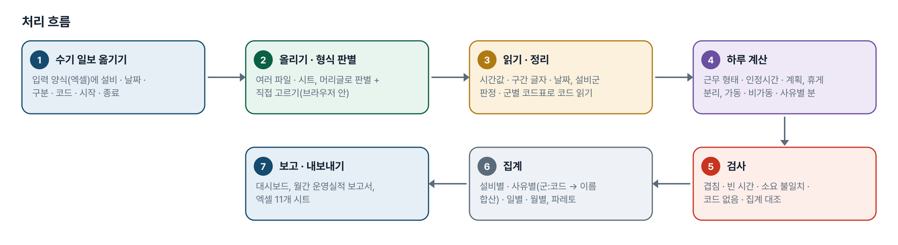
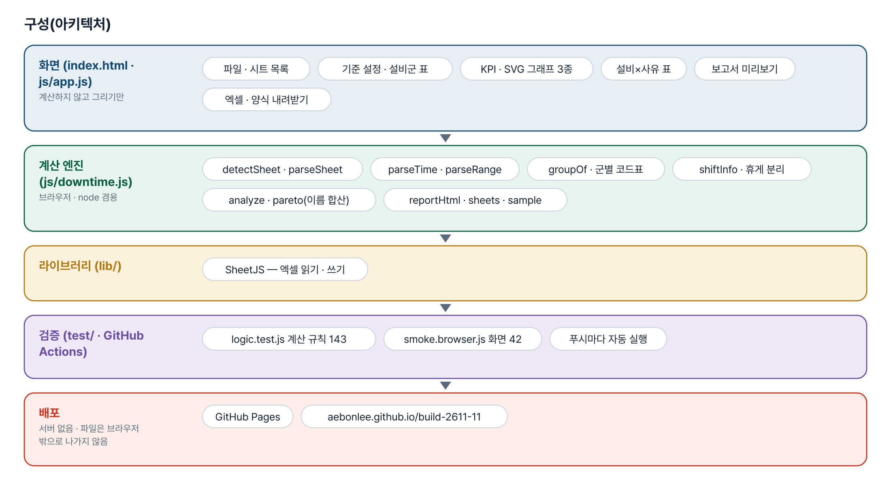
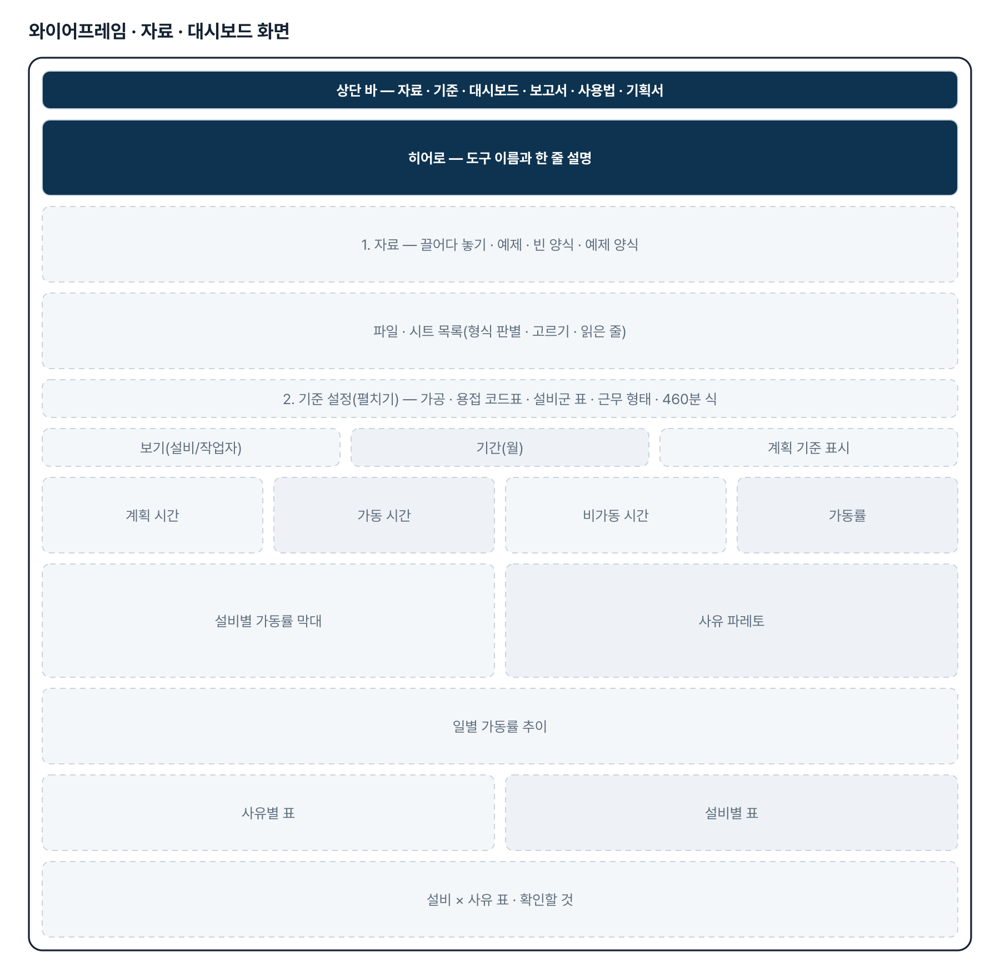
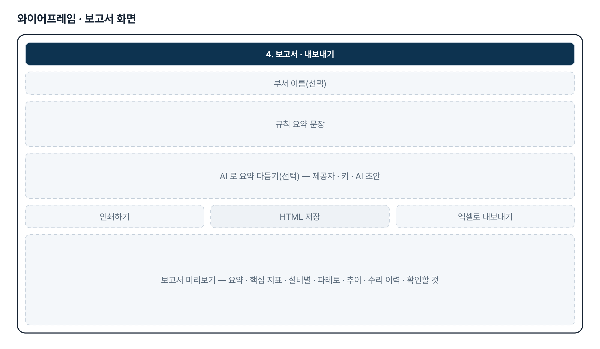
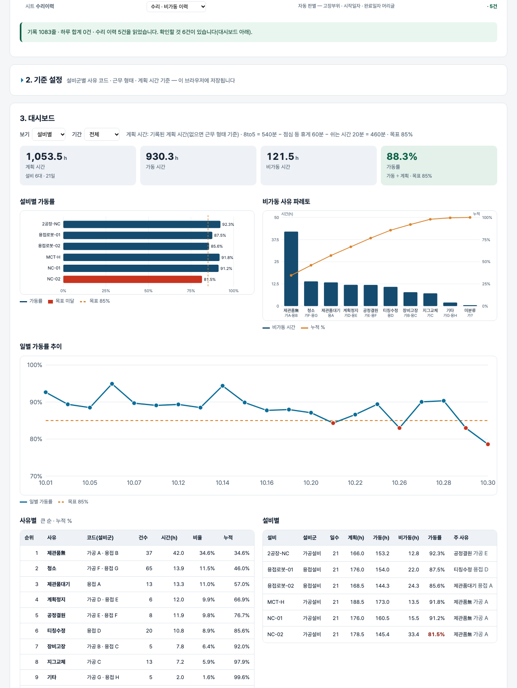

# 설비 비가동 집계 · 가동률 보고서 — 프로젝트 기획서 v1.3

- 기획: 정한결 · 작성일 2026-11-04 · 생성형 AI 업무자동화 전문가과정 · 2차수 프로젝트 11
- 바로 쓰기: https://build-2611-11.jobability.co.kr/
- 워드 판: `docs/기획서/build-2611-11_정한결_설비비가동집계가동률보고서_기획서_v1.3.docx`

## 개요

수기 작업일보를 엑셀 양식으로 옮겨 올리면 설비별 · 사유별 비가동 시간과 가동률, 비가동 사유 파레토, 일별 추이와 월간 설비 운영실적 보고서를 만들어 주는 브라우저 도구입니다.

### 배경 · 현재 업무
- 가공설비 · 용접로봇의 비가동 이력은 현장에서 수기 생산작업일보로 받고, 엑셀로 옮겨 설비별 · 사유별로 다시 집계합니다.
- 작업자별 작업일보 · 일일 집계 · 설비 가동률 시트 · 수리 이력이 서로 다른 모양이라 합치고 맞추는 데 시간이 듭니다.
- 옮겨 적는 과정의 겹친 구간 · 빠진 시간 · 소요 계산 실수가 가동률에 그대로 섞여도 알아차리기 어렵습니다.

### 목표
- 수기 일보를 옮겨 적을 엑셀 입력 양식을 주고, 올리면 바로 집계합니다.
- 기존 자료 형식(작업일보 · 일일 집계 · 가동률 시트 · 수리 이력)을 머리글로 알아보고 같은 기준으로 합칩니다.
- 설비별 · 사유별 비가동, 가동률, 파레토, 일별 · 월별 추이를 한 화면에 보여 줍니다.
- 월간 설비 운영실적 보고서(인쇄용)와 엑셀을 만들고, 기록 실수는 「확인할 것」으로 짚습니다.

## 요구사항과 구현

| 기획서 요구 | 구현 |
|---|---|
| 비가동 이력 집계(수기로 받음) | 입력 양식(설비 · 날짜 · 구분 · 코드 · 시작 · 종료 · 소요 · 내용) + 범례 시트, 다시 올리면 바로 집계 |
| 기존 자료 여러 형식 | 머리글로 형식 자동 판별(입력 양식 · 작업일보 · 일일 집계 · 가동률 시트 · 수리 이력) + 시트마다 직접 고르기 |
| 시간 · 구간 읽기와 휴게 분리 | 엑셀 시간값 · HH:MM · 「10.01 11:00 ~ 11:30」 구간, 휴게 줄 분리 · 휴게와 겹친 분 빼기 |
| 설비군별 사유 코드(기획자 답) | 가공 A~G · 용접 A~H 코드표, 설비군 자동 판정 + 설비별 고르기, 키는 군+코드 · 표시는 이름(같은 이름 합산 · 출처 표시) |
| 실제 설비 이름으로 설비군 판정(기획자 댓글 2 · v1.2) | 용접 라인 MAIN · BOOM · TRACK · SUB · CHASSIS · ARM · BUCKET · BLADE(N호기 · 대소문자 · 띄어쓰기 무관) → 용접, NC · MCT · 밀링 · 호리젠탈 · 머시닝 → 가공, 둘 다면 「확인 필요」. 기획자 설비 목록 30대 한 번에 등록 단추 · 범례 시트 목록 |
| 가동률 분석 | 가동 ÷ 계획(계획 0 이면 빈칸). 8to5 = 540 − 점심 60 − 쉬는 시간 20 = 460분, 계획 기준 고르기 |
| 설비별 · 사유별 · 일별 · 월별 | KPI · 설비별 막대(목표선) · 파레토(누적 %) · 일별 추이 · 설비×사유 표, 설비/작업자 보기 |
| 기록 검사 | 소요 불일치 · 구간 겹침 · 빈 시간 · 코드 없음 · 집계 대조 · 수리 총시간 대조 → 확인할 것 |
| 설비 운영실적 보고 | 인쇄용 HTML(규칙 요약 문장 · 그림 · 표), 선택 AI 다듬기, 엑셀 11개 시트 |
| (v1.3) 작성된 작업일보 스캔본을 입력시키면 자동으로 변환해서 집계(기획자 댓글 2026-11-04, 양식 2종 드라이브 공유) | scan.html — 스캔본(사진 · PDF) 올리기 → AI 비전(OpenAI/Anthropic, 키 + 외부 전송 확인)으로 머리 · 비가동 내역 · 작업/생산 현황을 JSON 으로 읽기 → 원본 옆에서 확인 · 수정(범례 · 시각 · 날짜 · 겹침 검사) → 입력 양식 줄로 바꿔 집계 화면에 파일처럼 올리기. 키 없으면 「손으로 입력」 |

## 주요 기능

- **입력 양식** — 빈 양식 · 채운 예제 양식을 내려받습니다. 설비 · 날짜는 윗줄과 같으면 비워도 되고, 비가동만 적어도 됩니다.
- **형식 판별 · 읽기** — 파일 여러 개 · 시트 여러 장을 머리글로 판별해 읽고, 시트마다 읽은 줄 수와 판별 이유를 보여 줍니다.
- **기준 설정** — 설비군별 사유 코드표(가공 A~G · 용접 A~H), 설비군 표(설비마다 이름 판정 + 고르기, 「확인 필요」 표시), 기획자 설비 목록(2026-11) 30대 불러오기, 근무 시간 · 휴게 · 쉬는 시간, 계획 기준, 목표 가동률을 고치면 바로 다시 계산합니다.
- **대시보드** — 계획 · 가동 · 비가동 · 가동률 KPI, 설비별 가동률 막대, 사유 파레토(같은 이름은 합치고 가공 B · 용접 C 처럼 출처 표시), 일별 추이, 설비×사유 표를 SVG 로 그립니다.
- **확인할 것** — 겹친 구간, 휴식보다 긴 빈 시간, 소요 불일치, 코드 없는 비가동, 읽지 못한 줄을 파일 · 시트 · 행과 함께 모읍니다.
- **보고서 · 엑셀** — 월간 설비 운영실적 보고(인쇄 · HTML), 회사 가동률 시트 모양을 포함한 엑셀 11개 시트를 내보냅니다.
- **(v1.3) 스캔본 읽기** — 손으로 쓴 생산작업일보 · 용접 ROBOT 가동일보 스캔본을 AI 비전으로 읽어 원본 옆에서 확인 · 수정한 뒤 입력 양식으로 보냅니다. 못 읽은 칸은 비워 두고 알립니다.

## 처리 흐름(파이프라인)

1. **수기 일보 옮기기** — 입력 양식(엑셀)에 설비 · 날짜 · 구분 · 코드 · 시작 · 종료
2. **올리기 · 형식 판별** — 여러 파일 · 시트, 머리글로 판별 + 직접 고르기(브라우저 안)
3. **읽기 · 정리** — 시간값 · 구간 글자 · 날짜, 설비군 판정 · 군별 코드표로 코드 읽기
4. **하루 계산** — 근무 형태 · 인정시간 · 계획, 휴게 분리, 가동 · 비가동 · 사유별 분
5. **검사** — 겹침 · 빈 시간 · 소요 불일치 · 코드 없음 · 집계 대조
6. **집계** — 설비별 · 사유별(군:코드 → 이름 합산) · 일별 · 월별, 파레토
7. **보고 · 내보내기** — 대시보드, 월간 운영실적 보고서, 엑셀 11개 시트

## 구성(아키텍처)

- **화면 (index.html · js/app.js)** — 파일 · 시트 목록 · 기준 설정 · 설비군 표 · KPI · SVG 그래프 3종 · 설비×사유 표 · 보고서 미리보기 · 엑셀 · 양식 내려받기
- **계산 엔진 (js/downtime.js)** — detectSheet · parseSheet · parseTime · parseRange · groupOf · 군별 코드표 · shiftInfo · 휴게 분리 · analyze · pareto(이름 합산) · reportHtml · sheets · sample
- **라이브러리 (lib/)** — SheetJS — 엑셀 읽기 · 쓰기
- **검증 (test/ · GitHub Actions)** — logic.test.js 계산 규칙 143 · smoke.browser.js 화면 42 · 푸시마다 자동 실행
- **배포** — GitHub Pages · aebonlee.github.io/build-2611-11

## 화면 구성(와이어프레임)

## 규칙 · 판정 기준

- 가동률 = 가동 ÷ 계획. 계획은 1일 작업시간 − 점심 60분 − 쉬는 시간 20분(기획자 기준 8to5 = 460분, 주간+야간 610분)이며, 기록된 계획 시간이 있으면 그것을 고를 수 있습니다.
- 사유 코드는 설비군마다 다릅니다(가공 A~G · 용접 A~H). 설비군은 양식의 설비군 칸 → 기준 설정 → 설비 이름 순으로 정합니다. 이름에 로봇 · 용접 · ABB · KOBE · 야스카와 또는 용접 라인 MAIN · BOOM · TRACK · SUB · CHASSIS · ARM · BUCKET · BLADE(N호기)가 있으면 용접, NC · CNC · MCT · 밀링 · 호리젠탈 · 머시닝 · 선반이 있으면 가공, 둘 다 있으면 「확인 필요」로 가공으로 세고 확인할 것에 올립니다.
- 집계 키는 군+코드라 용접 C(장비고장)와 가공 C(지그교체)가 섞이지 않습니다. 파레토 · 표는 같은 이름을 합치고 어느 군 코드에서 왔는지 보입니다.
- 가동 · 비가동 구간이 휴게 구간과 겹치면 겹친 분을 뺍니다. 가동을 적지 않은 날은 가동 = 계획 − 비가동입니다.
- 겹친 구간, 쉬는 시간보다 긴 빈 시간, 소요 기록 ↔ 계산 차이, 코드 없는 · 그 군 코드표에 없는 비가동은 확인할 것으로 올립니다.
- 같은 날을 작업일보와 일일 집계로 받으면 작업일보를 쓰고 집계는 대조만 합니다.
- (v1.3) AI 답은 JSON 만 꺼내고 시각(HH:MM) · 날짜(YYYY-MM-DD) · 범례(A~H)로 정리한다. 용접 양식의 생산 현황 줄에 범례가 적히면 비가동으로 옮긴다. 범례 코드가 없거나 그 설비군 코드표에 없음 · 시각 못 읽음 · 역순 · 겹침 · AI 가 못 읽은 칸 · 확신 낮음은 「확인할 것」.
- (v1.3) 입력 양식 변환: 비가동 줄 → 구분 비가동 · 코드(양식 범례 이름으로 집계 코드표를 다시 찾음) · 시작 · 종료 · 소요 · 내용(범례 이름 — 내역), 작업 줄 → 가동. 종료가 17:00 을 넘으면 주간+야간. 빈 줄은 보내지 않는다.

## 검증

- 계산 규칙 테스트 208개 · 화면 연기 테스트 66개 통과
- v1.2: 기획자 실제 설비 이름 30대(가공 10 · 용접 20)가 전부 올바른 군으로 판정되는지, 「NC 용접기」 같은 혼합 이름은 확인 필요로 올라가는지, 불러오기가 이미 고른 이름을 덮어쓰지 않는지, 범례 시트에 목록이 드는지를 고정했습니다. 용접 라인 이름 빼기 · 혼합을 조용히 용접으로 · 덮어쓰기 · 범례 목록 빼기 · 영문 경계 빼기 · 가공 낱말 빼기 · 확인할 것 생략을 각각 넣으면 1~4개가 실패합니다.
- 테스트를 일부러 깨뜨려 확인했습니다 — 휴게 분리 · 파레토 정렬 · 계획 0 처리 · 누락 · 겹침 · 소요 검사 · 두 번 세기 · 시간값 · 야간 판정 · 코드 뽑기를 바꾸면 각각 실패합니다.
- v1.1: 용접을 가공 코드표로 읽기 · 이름 합산 끄기 · 키에서 군 빼기 · 설비군 판정 끄기 · 설비군 칸 무시를 각각 넣으면 새 테스트가 실패합니다. 처음엔 용접을 가공 코드표로 읽어도 통과해서 용접 H · 사유 이름 테스트를 더했습니다.
- 가동률 양식으로 내보낸 시트를 다시 읽으면 계획 · 가동 · 비가동 합과 설비별 가동률이 같은지 테스트로 고정했습니다.
- 화면 테스트: 예제 → KPI · 파레토(군별 출처) · 추이 → 설비군 바꿔 재계산 · 되돌리기 → 기준 변경 → 보고서 · 엑셀 · 양식 → samples 다시 올리기 → 360px.
- (v1.3) 되돌려 확인: 용접 범례 줄 → 비가동 이동 끄기 4 · 겹침 검사 끄기 1 · 범례 이름 → 집계 코드 바꾸기 끄기 1 실패 → 원복 208.

## 이번 판에서 하지 않는 것

- 수기 일보 사진은 바로 읽지 않습니다 — 엑셀 양식으로 옮긴 자료만 읽습니다.
- 근태 시트와 월별 요약 시트는 읽지 않습니다.
- 가동률 시트의 비가동 내역에는 분이 없어 사유가 여럿이면 시간을 똑같이 나눈 추정입니다.
- 작업일보는 작업자 이름으로 설비군을 정합니다 — 용접 작업자는 기준 설정에서 용접설비로 바꿔야 합니다.
- 설비군 이름 판정은 낱말 기준입니다 — 목록에 없는 새 이름(예: 제조사명만 적은 로봇)은 가공으로 떨어질 수 있으니 기준 설정에서 고르거나 양식의 설비군 칸을 적습니다.
- 엑셀 양식의 드롭다운은 넣지 않았습니다(범례 시트로 대신).
- (v1.3) 키 없이 손글씨를 자동 인식하지 않는다(브라우저 OCR 은 믿을 만큼 읽지 못함). OpenAI 로는 PDF 를 보낼 수 없어 사진으로 올리거나 Anthropic 을 쓴다. 실제 기입된 스캔본으로는 아직 시험하지 못했다(빈 양식만 받음).

## 다음 단계

- 기획자 실제 가동률 시트에 맞춘 판별 · 단위 조정
- 근태 시트로 작업자 인정시간 · 연장근무 반영
- 월별 요약(설비군 × 12개월) 생성 · 전년 대비
- 수리 이력 ↔ 장비고장(B) 자동 대조
- (v1.3 이후) 기획자가 실제 기입된 스캔본을 올리면 지시문 · 검사 보강

## 버전 이력

- **v1.3** (2026-11-04) — 기획자 댓글(2026-11-04 「작성된 작업일보 스캔본을 입력시키면 자동으로 변환해서 집계」, 양식 2종 드라이브 공유) 대응 — 스캔본 읽기 화면(scan.html · js/scanread.js · js/scan.js) / AI 비전(OpenAI gpt-4o-mini 사진 / Anthropic claude-haiku-5-5 사진 · PDF)으로 읽기 → 확인 · 수정 → 입력 양식 변환 → 집계 화면(index.html#scan)에 파일처럼 올리기 · 엑셀 내려받기 · 손으로 입력 / 테스트 판정 163→208 · 화면 66
- **v1.2** (2026-11-03) — 기획자 댓글 2(실제 설비 이름 30대) 반영 — 용접 라인 MAIN · BOOM · TRACK · SUB · CHASSIS · ARM · BUCKET · BLADE(N호기 · 대소문자 · 띄어쓰기 무관)를 용접으로, NC · CNC · MCT · 밀링 · 호리젠탈 · 머시닝 · 선반을 가공으로 명시. 「MAIN 1호기」가 가공으로 잘못 잡히던 것을 고침 / 가공 · 용접 낱말이 둘 다 있는 이름(「NC 용접기」)은 「확인 필요」 — 가공으로 세되 확인할 것과 설비군 표에 표시하고 사용자가 고름 / 기준 설정 설비군 표에 「기획자 설비 목록(2026-11) 불러오기」(30대 한 번에, 이미 있는 이름은 그대로) · 「직접 고른 설비군 모두 지우기」. 입력 양식 범례 시트 아래에 같은 목록 / 예제 설비 이름은 그대로(용접로봇-01/02 여전히 용접). 계산 테스트 163 · 화면 테스트 47
- **v1.1** (2026-11-03) — 기획자 댓글 반영 — 사유 코드를 설비군별로: 가공설비 A~G · 용접설비 A~H(티칭수정 등), 설비군 자동 판정(로봇 · 용접 · ABB · KOBE · 야스카와 …) + 기준 설정에서 설비별 고르기 / 집계 키를 군+코드로 바꾸고, 파레토 · 설비×사유 표는 같은 이름을 합쳐 「가공 B · 용접 C」 처럼 출처 표시. 입력 양식에 설비군 열(선택) / 가동률 기준 식(8to5 = 540 − 점심 60 − 쉬는 시간 20 = 460분)을 기준 설정 · 범례 · 보고서 · 엑셀에 표기 / 예제의 용접로봇이 용접 코드표를 쓰도록 다시 만들고 samples 재생성. 계산 테스트 143 · 화면 테스트 42
- **v1.0** (2026-11-03) — 첫 판 — 입력 양식 · 형식 자동 판별 · 휴게 분리 · 가동률 · 파레토 · 기록 검사 · 대시보드 · 운영실적 보고서 · 엑셀 / 기획서 워드 판·파이프라인·아키텍처·와이어프레임 추가
